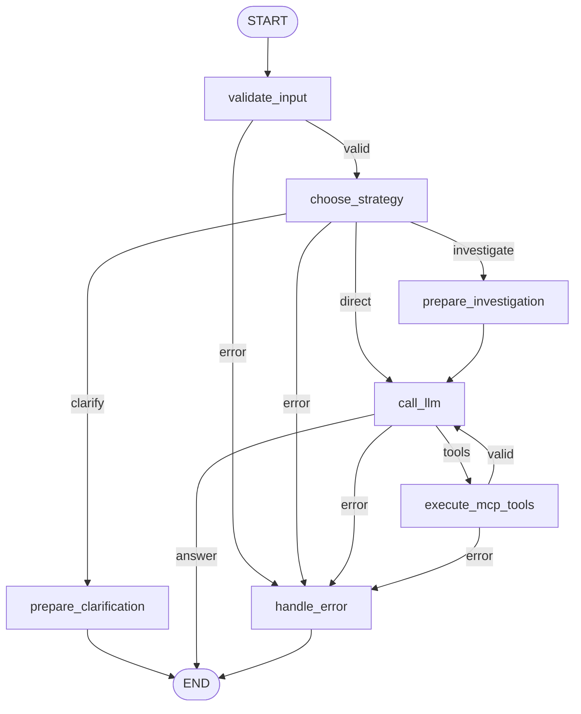

# contract-agent

## 1. О проекте

`contract-agent` — учебный проект на Python для изучения MCP (Model Context
Protocol), LangGraph, LangChain и LLM-агентов. На примере вымышленных договоров
он показывает путь от отдельного MCP-клиента и детерминированного workflow
до агента, который выбирает стратегию, вызывает инструменты и восстанавливается
после отдельных ошибок.

Основной агент умеет искать и изучать договоры, собирать данные для сравнения
и задавать уточняющий вопрос. Это локальный пример работы с данными, а не
система юридической экспертизы. В `data/contracts.json` сейчас четыре
вымышленных договора: `C-001`–`C-004`. Сервер предоставляет только чтение данных.

## 2. Технологический стек

| Компонент | Ответственность в проекте |
| --- | --- |
| Python 3.12+ и `uv` | Асинхронный код, запуск процессов, управление зависимостями и окружением; `uv.lock` фиксирует версии. |
| MCP | Обнаружение инструментов, передача аргументов и результатов между клиентом и отдельным серверным процессом. |
| LangGraph | Узлы графа, состояние, условные переходы и ограниченный цикл агента. |
| LangChain и `langchain-core` | Подключение chat-модели, structured output, `bind_tools()` и типизированные сообщения. |
| Pydantic | Модель `Contract`, проверка данных и решения `StrategyDecision`. |
| `jsonschema` | Проверка аргументов и результатов по схемам MCP-инструментов; установлен как зависимость MCP SDK. |
| Ollama и Qwen3 | Локальный LLM-провайдер и модель `qwen3:8b` для выбора стратегии, инструментов и формирования ответа. |
| Docker Compose | Запуск Ollama с NVIDIA GPU и сохранение моделей в отдельном томе. Python-приложение работает вне контейнера. |
| `unittest` / `pytest` | Текущие тесты написаны на стандартном `unittest`, включая `IsolatedAsyncioTestCase`. `pytest` не указан в зависимостях и не требуется для документированного запуска. |

## 3. Архитектура

`server.py` владеет набором договоров и публикует MCP-инструменты. Агент не
импортирует его функции: `Client` запускает сервер через `StdioServerParameters`,
а вызовы проходят по MCP через **stdio**. Схемы и результаты пересекают границу
процессов; сервер может использоваться и другим MCP-клиентом.

LangChain связывает приложение с LLM. Модель выбирает подход к запросу и доступные
инструменты. LangGraph управляет порядком выполнения, состоянием и переходами.
Python, Pydantic и JSON Schema проверяют решения, аргументы, ответы и лимиты.
Имена, сгенерированные моделью, не превращаются в произвольные вызовы Python.

Такое разделение делает видимыми три разных задачи: получение возможностей
через MCP, принятие контекстных решений моделью и детерминированное управление
выполнением. Для простого поиска хватило бы обычной async-функции; явный граф
здесь полезен для изучения маршрутизации и цикла агента.

Граф из `agent_workflow.py`:



`route_by_strategy`, `route_after_llm` и `route_after_validation` — функции
условной маршрутизации, а не отдельные узлы. Переход `valid` после
`execute_mcp_tools` включает успешные результаты и восстанавливаемые ошибки.

## 4. Структура проекта

```text
contract-agent/
├── AGENTS.md                    # Правила работы с репозиторием
├── README.md                    # Описание и запуск проекта
├── task.md                      # Текущее задание
├── pyproject.toml               # Зависимости и дополнительные провайдеры
├── uv.lock                      # Зафиксированные версии зависимостей
├── compose.yaml                 # Контейнер Ollama с NVIDIA GPU
├── models.py                    # Общая модель Contract
├── server.py                    # Данные и MCP-инструменты
├── client.py                    # Самостоятельный MCP-клиент
├── workflow.py                  # Детерминированный поиск через MCP
├── llm.py                       # Один запрос к LLM без графа и MCP
├── llm_workflow.py              # Простой граф с одним LLM-узлом
├── agent_workflow.py            # Выбор стратегии и цикл MCP-агента
├── data/
│   └── contracts.json           # Вымышленные договоры
└── tests/
    ├── test_mcp.py
    ├── test_workflow.py
    ├── test_llm.py
    ├── test_llm_workflow.py
    └── test_agent_workflow.py
```

Файлы Python расположены в корне: каждый пример можно запускать отдельно.
Сервер читает JSON один раз при старте, проверяет его через Pydantic и отклоняет
повторяющиеся ID. Путь к данным определяется относительно `server.py`, поэтому
не зависит от рабочей директории клиента.

## 5. Установка и запуск

### Требования

Нужны Python 3.12+, установленный `uv` и, для приведённого локального LLM-запуска,
Docker с Docker Compose. Текущий `compose.yaml` запрашивает NVIDIA GPU: нужен
совместимый драйвер и доступ GPU из контейнера. Для native Docker Engine
используется NVIDIA Container Toolkit; в Docker Desktop нужна соответствующая
поддержка GPU и интеграция WSL2. В WSL2 используется драйвер Windows.

Команды выполняются из корня репозитория в Bash. Проверьте Docker и GPU:

```bash
docker version
docker compose version
nvidia-smi
docker run --rm --gpus all --entrypoint nvidia-smi ollama/ollama:latest
ss -ltnp 'sport = :11434'
```

Доступность `nvidia-smi` в системе ещё не подтверждает доступ из контейнера.
Если порт `11434` уже занят работающим Ollama, используйте его вместо запуска
второго экземпляра. Готовой конфигурации Compose без GPU в проекте нет.

### Зависимости и Ollama

Для примеров с MCP без LLM достаточно `uv sync --locked`. Для локального агента:

```bash
uv sync --locked --extra ollama
docker compose up -d ollama
docker compose logs --tail 50 ollama
curl --noproxy '*' http://127.0.0.1:11434/api/version
docker compose exec -T ollama ollama pull qwen3:8b
docker compose exec -T ollama ollama list
export LLM_PROVIDER=ollama
export LLM_MODEL=qwen3:8b
uv run --locked --extra ollama agent_workflow.py \
  "Find contracts involving Harbor Labs and summarize their titles. /no_think"
```

`LLM_PROVIDER` и `LLM_MODEL` обязательны для LLM-примеров; значений по умолчанию
нет. Приложение читает окружение и не загружает `.env`. Суффикс `/no_think`
в примерах является частью запроса к Qwen3, а не CLI-флагом приложения.

Compose публикует API на `127.0.0.1:11434`, хранит модели в томе `ollama_models`
и использует `restart: unless-stopped`. Образ `ollama/ollama:latest` не фиксирует
версию сервера. После запроса можно проверить использование GPU:

```bash
docker compose exec -T ollama ollama ps
nvidia-smi
```

В `ollama ps` смотрите столбец `PROCESSOR`. Для диагностики подключения и GPU
используйте `docker compose ps -a` и `docker compose logs --tail 100 ollama`.
Если модель не найдена, выполните `ollama pull` из примера выше.

```bash
docker compose stop ollama
docker compose start ollama
```

`docker compose down` удаляет контейнер и сеть, сохраняя том моделей.
Вариант с `-v` удаляет и модели.

В `pyproject.toml` также есть extras `openai` и `anthropic`; им соответствуют
`LLM_PROVIDER=openai` / `anthropic` и переменные `OPENAI_API_KEY` /
`ANTHROPIC_API_KEY`. Эти провайдеры требуют отдельной интеграции и облачного
доступа, а модель агента — поддержки structured output и tool calling.
Примеры в этом README используют локальный Ollama без платных API.

### Отдельные учебные примеры

```bash
uv run --locked client.py
uv run --locked workflow.py "  HARBOR LABS  "
uv run --locked --extra ollama llm.py "Explain MCP in two sentences. /no_think"
uv run --locked --extra ollama llm_workflow.py "Explain LangGraph in two sentences. /no_think"
```

`client.py` показывает обнаружение инструментов и вызовы MCP. Его текущий
пример запрашивает несуществующий `C-991` и завершается ошибкой после
`list_contracts`, не доходя до остальных вызовов. Для успешного поиска без LLM
используйте `workflow.py`: он нормализует имя стороны, вызывает фиксированный
инструмент и проверяет результат. Ошибки идут в `handle_error`; этот пример
печатает также диагностические сообщения, а не только JSON.

`llm.py` выполняет один запрос без графа. `llm_workflow.py` показывает путь
`validate_input -> call_llm -> END` с отдельной веткой ошибок, без MCP.

Агент и MCP-примеры сами запускают `server.py`; отдельный сервер им не нужен.
Команда `uv run --locked server.py` предназначена для запуска stdio-сервера
другим MCP-клиентом: он ожидает протокольные сообщения на stdin, а не ввод
запросов человеком. Протокольный stdout нельзя смешивать с диагностикой.

## 6. MCP-инструменты

| Инструмент | Параметры | Поведение |
| --- | --- | --- |
| `list_contracts` | Нет | Все полные договоры в порядке набора данных. |
| `get_contract` | `contract_id: str` | Договор по точному ID с учётом регистра. Неизвестный ID вызывает ошибку инструмента. |
| `search_contracts` | `query: str` | Поиск подстроки в ID, заголовке, сторонах, дате в ISO-формате и тексте. Игнорирует регистр и пробелы по краям запроса. |
| `find_contracts_by_party` | `party: str` | Совпадение полного имени стороны после `strip()` и `casefold()`. Например, `Harbor` не совпадает с `Harbor Labs`. |
| `find_contract_by_party` | `party: str` | Совместимый псевдоним `find_contracts_by_party`, также возвращает список. |

Пустой поисковый запрос или отсутствие совпадений дают пустой список.
Одиночный договор возвращается как структурированный объект; списки в
`structured_content` обёрнуты в `{"result": [...]}`.

Декоратор `@mcp.tool()` регистрирует функции; MCP SDK формирует JSON Schema
из аннотаций типов, а описания — из docstrings. При первом `call_llm` агент
вызывает `Client.list_tools()`, обрабатывает страницы результатов и сохраняет
метаданные в состоянии. Затем передаёт имена, описания и входные схемы в
LangChain `bind_tools()`. Модель выбирает из этих возможностей, а исполнение
всегда идёт через `Client.call_tool()`. Python-функции сервера напрямую не вызываются.

## 7. Как работает агент

### Состояние и стратегия

`AgentState` — `TypedDict` с полями `prompt`, `messages`, `response`, `error`,
`tool_rounds`, `tools` и `strategy_decision`. Аннотации описывают структуру,
но проверки во время выполнения реализованы отдельно.

1. `validate_input` принимает только непустую строку, удаляет пробелы по краям
   и создаёт `SystemMessage`, `HumanMessage`, счётчик `0` и `error=None`.
2. `choose_strategy` делает один запрос к настроенной модели через
   `with_structured_output(StrategyDecision)`, без открытия MCP-клиента.
   Решение проверяется Pydantic: допустимы только три стратегии, непустой
   `reason` длиной до 240 символов и непустой вопрос для `clarify`.
   Лишние поля запрещены. Краткая причина выбора не предназначена для вывода
   внутреннего рассуждения модели. Ошибка разбора или запроса завершает граф;
   запасной стратегии или JSON-fallback нет.
3. `route_by_strategy` детерминированно выбирает ветку:
   `direct` ведёт в `call_llm`; `investigate` — в `prepare_investigation`,
   который сохраняет историю и добавляет `SystemMessage` о сборе доказательств;
   `clarify` — в `prepare_clarification`, который записывает вопрос в `response`
   и завершает запуск без MCP. Последовательность инструментов не задана заранее.

Выбор стратегии хранится отдельно от сообщений агента. Отсутствие ID в запросе
само по себе не требует уточнения: модель может выбрать поиск по стороне
или критериям. Решение зависит от LLM, а не от поиска ключевых слов в Python.

### Цикл инструментов и ошибки

`call_llm` подключает обнаруженные инструменты и передаёт разговор модели.
Ответ должен быть `AIMessage` без некорректно разобранных tool calls. Ответ
без вызовов становится итоговым `response`; запросы инструментов ведут в
`execute_mcp_tools`.

Перед выполнением Python проверяет имена и уникальные непустые ID всех вызовов
пакета. Затем последовательно проверяет аргументы по входной JSON Schema
и вызывает MCP. Структурированный успешный результат проверяется по выходной
схеме, если она есть, и сериализуется в JSON. Для инструментов без выходной
схемы поддерживается также текстовый ответ.

Каждый продолжающий разговор вызов получает `ToolMessage` с именем инструмента
и исходным `tool_call_id`. Модель видит результаты и сама решает, нужны ли новые
вызовы или можно отвечать.

| Тип ошибки | Реакция |
| --- | --- |
| Неверные аргументы или ответ MCP с `is_error=True` | Восстанавливаемая ошибка: краткий `ToolMessage(status="error")`, обработка остальных вызовов пакета и возврат в `call_llm`. Модель может исправить запрос, выбрать другой инструмент или ответить. |
| Неизвестный инструмент, пустой или повторяющийся ID, сбой транспорта, повреждённый ответ, нарушение выходной схемы | Фатальная ошибка: запись в `error`, переход в `handle_error -> END`. После частичного выполнения оставшиеся вызовы не исполняются и новый запрос к модели не делается. |
| Ошибка конфигурации, выбора стратегии, обнаружения инструментов или LLM | Фатальная ошибка с завершением графа. |

`MAX_TOOL_ROUNDS = 5`: один завершённый пакет считается одним раундом независимо
от числа вызовов и восстанавливаемых ошибок. Пакет с неверными аргументами у всех
вызовов тоже расходует раунд. После пятого модель ещё может ответить, но шестой
пакет блокируется до исполнения. Автоматического повторного вызова Python нет.

CLI агента печатает итоговый ответ в stdout. Фатальная ошибка выводится в stderr
с кодом завершения `1`; `handle_error` сам ничего не печатает.

### Трассировка

Без `--trace` используется `ainvoke()`. С флагом —
`astream(..., stream_mode="updates")`: на stderr видны завершённые узлы,
стратегия, краткая причина, ветка, новые сообщения, аргументы, ID и раунды.
Успех отмечается `status=success`, восстанавливаемая ошибка —
`status=error recoverable_error=...`.

`updates` содержит частичные обновления по именам узлов. CLI объединяет их
в локальное состояние для получения итогового ответа. В этом графе поля
заменяются, reducers отсутствуют; узлы возвращают всю историю сообщений,
но CLI показывает только новые сообщения. Обновление `None` означает отсутствие
изменений состояния.

Длинные поля сокращаются; результаты договоров показывают количество и до трёх
ID с заголовками вместо полного текста. Метаданные модели и окружение не
выводятся. Фрагменты запроса и сообщений видны: трассировка не является
универсальным механизмом скрытия секретов. Она показывает завершение узлов,
а не отдельные токены; полный итоговый ответ остаётся в stdout.

## 8. Примеры использования

После настройки окружения из раздела 5:

```bash
uv run --locked --extra ollama agent_workflow.py \
  "Find contracts involving Harbor Labs and summarize their titles. /no_think"

uv run --locked --extra ollama agent_workflow.py \
  "Compare contracts C-002 and C-003: their parties, signing dates, purposes, and key obligations. /no_think"

uv run --locked --extra ollama agent_workflow.py \
  "Show the key terms of contract C-001. /no_think"

uv run --locked --extra ollama agent_workflow.py \
  "Please analyze that agreement. /no_think"

uv run --locked --extra ollama agent_workflow.py --trace \
  "Find contracts involving Harbor Labs and summarize their titles. /no_think" \
  2>trace.log
```

Первый запрос предполагает поиск по стороне; в текущих данных `Harbor Labs`
участвует в `C-002`, `C-003` и `C-004`. Сравнение подходит для `investigate`,
изучение конкретного договора — для `direct`. Запрос без указания договора
или критериев может привести к `clarify`. Формулировки ответа, выбранная ветка
и последовательность инструментов могут различаться: CLI не фиксирует решение LLM.

Для восстановления после ошибки можно сначала запросить неизвестный договор:

```bash
uv run --locked --extra ollama agent_workflow.py --trace \
  "First call get_contract for C-991. If it is not found, use list_contracts and summarize the available contract titles. /no_think"
```

Ожидаемый путь восстановления: `get_contract` возвращает ошибку инструмента,
модель получает соответствующий `ToolMessage` и может вызвать `list_contracts`.

## 9. Тестирование

Основной запуск не требует работающего Ollama:

```bash
uv sync --locked
uv run --locked python -m unittest discover -s tests -v
```

| Модуль | Что проверяется |
| --- | --- |
| `tests/test_mcp.py` | Настоящий stdio-сервер: обнаружение, схемы, чтение, поиск, неверные аргументы и ошибки ID. Сервер запускается также из другой рабочей директории. |
| `tests/test_workflow.py` | Поиск через настоящий MCP, нормализация, порядок узлов, пустые результаты и проверки ответа; сбои дополнительно моделируются mocks. |
| `tests/test_llm.py` | Настройки провайдера, сообщения и вывод с mocked LLM. |
| `tests/test_llm_workflow.py` | Валидация, успешные и ошибочные пути графа, CLI с mocked LLM. |
| `tests/test_agent_workflow.py` | Три стратегии, невалидные решения, сохранение разговора, tool calls, восстановление, фатальные ошибки, пакеты, лимит и трассировка с mocked LLM и MCP. |

Интеграционные тесты учитывают четыре договора `C-001`–`C-004` и совпадения
`Harbor Labs` для `C-002`, `C-003` и `C-004`. Проверяются точные списки ID
и порядок результатов. Тесты с mocked данными используют собственные
фиксированные ответы, независимо от числа договоров в JSON.

## 10. Ограничения и дальнейшее развитие

Сейчас каждый CLI-запуск начинает новый разговор. Постоянной памяти,
LangGraph Checkpointer и продолжения после вопроса `clarify` нет.
Нет базы данных, изменений договоров, параллельного выполнения инструментов,
внешнего мониторинга или потокового вывода токенов.

При обнаружении и каждом раунде открывается новый MCP-клиент с отдельным
серверным процессом. Это упрощает жизненный цикл локального примера, но добавляет
расходы на запуск. Модель создаётся и привязывается к инструментам при каждом
`call_llm`; выбор стратегии добавляет ещё один LLM-запрос. Лимит ограничивает
раунды инструментов, но не количество вызовов в одном пакете.

JSON Schema проверяет структуру ответа, но не достоверность выводов модели.
Инструкция трактовать результаты как данные не гарантирует защиту от любых
нежелательных инструкций внутри текста. Поддержка structured output и tool
calling зависит от провайдера и модели; при несовместимости агент завершает
запуск с ошибкой. Версии Python-зависимостей фиксирует `uv.lock`, но `latest`
в Compose не обеспечивает воспроизводимость версии Ollama.

Планируемые учебные направления: LangGraph Checkpointer для сохранения состояния
и multi-turn conversations для продолжения диалога после уточнения. Это будущие
шаги, а не реализованные возможности текущего агента.
